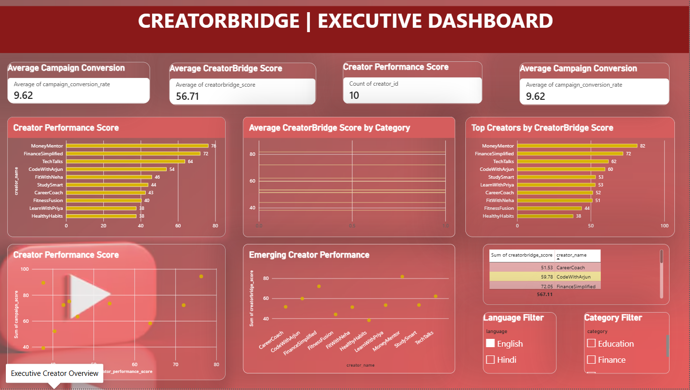

# CreatorBridge | YouTube Creator & Brand Analytics Platform

### Turning Creator Data into Smarter Marketing Decisions


CreatorBridge is a data-driven analytics project designed to help brands evaluate YouTube creators, understand audience patterns, and analyze influencer marketing campaign performance.

By combining Python-based data processing, SQL, a Streamlit application, and interactive Power BI dashboards, CreatorBridge demonstrates how creator and campaign metrics can be transformed into meaningful business insights.

**Project Focus:** Creator Analytics | Influencer Marketing | Campaign Performance | Business Intelligence | Data Visualization

---

## 📊 Dashboard Preview

CreatorBridge includes four Power BI dashboard pages for exploring creator performance, campaign effectiveness, and audience insights.

### 1. Executive Dashboard

A high-level overview of key creator and campaign performance indicators.



### 2. Creator Performance

Compare creator scores, engagement rates, average views, and category-level performance.


### 3. Campaign Analytics

Explore campaign views, clicks, conversions, and conversion-rate metrics.


### 4. Audience Insights

Analyze creator distribution by language and category, along with subscriber-related metrics.


---

## 🖥️ Streamlit Application Preview

The Streamlit application provides a Python-powered interface for exploring creator analytics, campaign-related insights, and data quality indicators.

### 1. Creator 360


### 2. Creator Comparison


### 3. Campaign Simulator


### 4. Data Quality


### 5. Executive Overview


### 6. Campaign Intelligence


### 7. Audience Intelligence


---

## 🎯 Business Problem

Choosing the right YouTube creator for an influencer marketing campaign involves more than looking at subscriber counts. Brands also need to consider engagement, audience relevance, campaign reach, clicks, conversions, and overall performance.

CreatorBridge explores how data analytics can help address these challenges by bringing creator metrics, audience indicators, and campaign performance measures into a structured analytical solution.

### Project Objectives

- Evaluate and compare YouTube creator performance.
- Analyze engagement rates, views, and subscriber counts.
- Compare creator performance across categories and languages.
- Measure campaign views, clicks, conversions, and conversion rates.
- Develop a calculated scoring approach for creator comparison.
- Present insights through interactive Power BI dashboards.
- Provide a Python-based interface for exploring analytics.

---

## ✨ Key Features

### 👤 Creator Performance Analytics

- Creator-level performance comparison.
- Engagement-rate and average-views analysis.
- CreatorBridge Score-based ranking.
- Category-level performance comparisons.
- Identification of creators with stronger measured performance.

### 📈 Campaign Analytics

- Campaign views, clicks, and conversions analysis.
- Creator-level campaign comparisons.
- Conversion-rate analysis.
- Campaign score comparisons.
- Performance indicators to support marketing evaluation.

### 🌍 Audience Insights

- Creator distribution by language.
- Creator distribution by category.
- Subscriber analysis across categories.
- Comparison of creator categories across languages.
- Creator-level profile and audience-related indicators.

### 📊 Interactive Power BI Dashboards

| Dashboard Page | Purpose |
|---|---|
| Executive Dashboard | Overall performance overview |
| Creator Performance | Creator comparison and engagement analysis |
| Campaign Analytics | Campaign metrics and conversion analysis |
| Audience Insights | Category, language, and subscriber insights |

### 🐍 Streamlit Analytics Application

The project includes a Streamlit application with views for creator analysis, comparisons, campaign exploration, audience insights, and data quality.

The application and its utilities are included in the repository. The availability of any specific feature depends on the implemented application code and its configured data.

---

## 🛠️ Technology Stack

| Technology | Purpose |
|---|---|
| Python | Data processing, analysis, and application development |
| Pandas | Data manipulation and transformation |
| SQL | Data querying and analytical database concepts |
| Power BI | Interactive dashboards and business intelligence |
| Streamlit | Python-based analytics interface |
| Jupyter Notebook | Data generation and experimentation |
| Git | Version control |
| GitHub | Source code hosting and project collaboration |

---

## 🧮 CreatorBridge Scoring Approach

CreatorBridge incorporates calculated metrics to support creator and campaign comparisons.

The project dataset includes:

- **Creator Performance Score** — a creator-level performance indicator.
- **Campaign Score** — a metric for campaign-level comparison.
- **CreatorBridge Score** — a project scoring indicator for comparing creators.

These metrics help organize creator comparisons into a structured analytical framework. Their interpretation depends on the underlying formulas and available data. A higher score does not guarantee better results for every brand or campaign.

---

## 📁 Project Structure

```text
CreatorBridge/
│
├── data/                  # Project datasets and generated data
├── documentation/         # Project documentation
├── powerbi/               # Power BI dashboard report
├── python/                # Python notebooks and analysis
├── screenshots/           # Power BI and Streamlit previews
├── sql/                   # SQL scripts and queries
├── tests/                 # Project tests
├── web/                   # Streamlit application
│   ├── app.py
│   └── utils/
├── .gitignore
├── README.md
└── requirements.txt
```

---

## 🚀 Getting Started

Follow these steps to run CreatorBridge locally.

### Prerequisites

- Python installed on your system.
- Git installed on your system.
- Power BI Desktop to open the `.pbix` report.
- Dependencies listed in `requirements.txt`.

### Step 1: Clone the Repository

```bash
git clone https://github.com/Vaishnavi-175/creatorbridge-youtube-analytics.git
cd creatorbridge-youtube-analytics
```

### Step 2: Create a Virtual Environment

For Windows PowerShell:

```powershell
python -m venv .venv
.\.venv\Scripts\Activate.ps1
```

### Step 3: Install Dependencies

```bash
python -m pip install -r requirements.txt
```

### Step 4: Run the Streamlit Application

```bash
python -m streamlit run web/app.py
```

Open the local URL displayed in the terminal to access the application in your browser.

### Step 5: Open the Power BI Dashboard

Open the report in Power BI Desktop:

[**CreatorBridge Power BI Dashboard (.pbix)**](powerbi/CreatorBridge_YouTube_Analytics_Dashboard.pbix)

**Note:** Successful execution depends on compatible dependencies, available datasets, and correctly configured file paths.

---

## 💡 Business Questions Explored

CreatorBridge is designed to explore questions such as:

1. Which creators have stronger engagement relative to their audience size?
2. How does creator performance vary across categories?
3. Which creators generate higher campaign views and clicks?
4. How do campaign conversions and conversion rates compare?
5. How are creators distributed across languages and categories?
6. How can multiple performance indicators support creator selection?
7. Which metrics should brands consider when evaluating potential creator partnerships?

---

## 📌 Analytical Approach

The project brings together several areas of data analytics:

- **Descriptive Analytics:** Understand creator and campaign performance.
- **Comparative Analytics:** Compare creators, categories, and campaigns.
- **Performance Measurement:** Review engagement and conversion indicators.
- **Data Visualization:** Communicate findings through Power BI dashboards.
- **Application Development:** Explore analytics through a Streamlit interface.
- **Data Validation:** Support data quality checks through Python utilities.

---

## 📂 Data & Methodology

The project uses structured creator, video, and campaign metrics for analytical exploration.

Where generated or synthetic data is used, the results are intended for demonstration, testing, and methodology development. They should not be interpreted as verified real-world creator statistics or campaign outcomes.

Creator scores and conversion metrics should be evaluated alongside their calculation methods and underlying data. Real-world business use would require appropriate data validation and testing.

---

## 🔮 Future Improvements

Potential areas for further development include:

- Automated data ingestion from reliable sources.
- Expanded data quality checks and automated testing.
- Clearer documentation of scoring formulas.
- Additional creator discovery and filtering capabilities.
- Improved application deployment and performance.
- Evaluation using validated real-world campaign data.

---

## 👩‍💻 About the Project

CreatorBridge is a portfolio project exploring how data analytics and business intelligence can support influencer marketing decisions.

It demonstrates practical work across data preparation, analytical metrics, scoring concepts, interactive visualization, and Python application development.

**Developed by Vaishnavi**

- GitHub Profile: [@Vaishnavi-175](https://github.com/Vaishnavi-175)
- Project Repository: [CreatorBridge – YouTube Creator & Brand Analytics](https://github.com/Vaishnavi-175/creatorbridge-youtube-analytics)

---

### ⭐ CreatorBridge

*Connecting creator insights with smarter brand decisions.*
